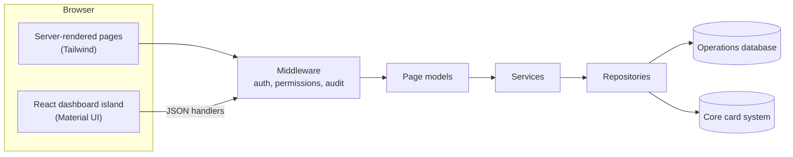

# VIGIL: ATM & Transaction Monitoring System

**A web application giving a bank's operations team a live view of its ATM network and card transactions, with real-time dashboards, operational and regulatory reporting, and user administration. Re-platformed from a legacy system onto .NET 10 with a React dashboard.**

> **About this repository**
> This project was built in a professional setting and its source code is the property of my employer. This repository is a **portfolio write-up only**: it contains no source code, no client data and no internal system details. Names, figures and workflows are described at a general level.

---

## Overview

A bank's operations team needs to know at a glance how today's card transactions are going, why transactions are being declined, which ATMs are out of service, and which are about to run out of cash. They also need detailed reports for day-to-day operations and for the central bank's regulatory requirements.

The original system was an ASP.NET Web Forms application with well over a hundred pages. I worked on **re-platforming it onto ASP.NET Core Razor Pages (.NET 10)** with a new design system and a React dashboard, while keeping full behavioural compatibility with the production database so the new application could replace the old one in place.

## My Role

- Re-platformed the in-scope functionality onto .NET 10 with a layered architecture.
- Built the two live operations dashboards as a React and Material UI component embedded in the server-rendered app.
- Delivered the reporting module with shared filter components and multi-format export.
- Designed and documented the design system, including dark mode and runtime accent colours.
- Hardened authentication and diagnosed legacy defects during the migration.
- Maintained the product across **four bank-specific deployments**, each with its own database, branding and report set.
- Took all four deployments through a corporate **SonarQube** compliance gate, from roughly 4,000 findings to a clean scan with no behaviour change.

## Key Features

**Live dashboards**
- KPI tiles for total, approved and declined transactions, with approval and decline rates.
- Hourly transaction volume and decline-reason charts, filterable by source channel and transaction type.
- **ATM fleet status** (in service, out of service, broken down by state) and **ATM cash position** (low cash, out of cash, and the ATMs with the least cash remaining).
- Per-user auto-refresh with a visible countdown and a pause control.

**ATM monitoring**
- Status views for in-service, out-of-cash, low-cash, fault and event states, with per-device drill-down (cassettes, note counts, card reader, printer and other device states).
- Wall-display mode: auto-refresh with pause and resume plus a session keep-alive, so screens can stay on all day in operations rooms.

**Reporting**
- 15 to 30+ operational and regulatory reports depending on the deployment: transaction detail and summaries, response-code analysis, ATM uptime, downtime and performance, out-of-cash incidents, idle ATMs, retained cards and regulatory statistics.
- Shared filter components (date ranges, region, ATM, multi-select lookups), server-side paging, and Excel, CSV, TXT and PDF export that carries the applied filters into the output.
- Exports are **streamed**, so memory stays flat even for result sets of hundreds of thousands of rows.

**Administration**
- User management, role management with a hierarchical permission tree, password reset and account unlock.
- Navigation built from each user's role permissions.

**User experience**
- Light and dark mode plus a user-selectable accent colour, remembered per browser.
- Fully keyboard operable with visible focus, skip links, landmarks and reduced-motion support.
- Works fully offline: every font, script and icon is self-hosted.

## Tech Stack

| Area | Technology |
|---|---|
| Back end | .NET 10, ASP.NET Core Razor Pages, C# |
| Data access | Dapper and ADO.NET over SQL Server stored procedures; ODBC for an IBM i system |
| Dashboard | React 19, Material UI, MUI X Charts, built with Vite |
| UI | Tailwind CSS 4, Flowbite, Chart.js, server-rendered partials |
| Exports | Excel and PDF generation libraries, CSV |
| Security | Cookie authentication, client-side credential encryption via WebCrypto, anti-forgery tokens |
| Hosting | IIS on Windows Server, offline intranet |

## Architecture

- **Layered design:** page model, service and repository for every feature, with dependency injection throughout (around 40 services and 40 repositories).
- **React island:** both dashboards share one self-contained React bundle that receives its mode and filter options from the host page, avoiding an extra round trip.
- **Database contract treated as fixed:** all reporting and administration use the existing database routines, so the new app is a drop-in replacement.

## Engineering Highlights

- **Large legacy consolidation.** Consolidated well over a hundred legacy pages and dozens of user controls into about 25 Razor Pages.
- **95%+ smaller front end.** Replaced a 97 MB bundle of legacy third-party themes with a 1.5 MB self-hosted build suitable for offline bank intranets.
- **Recovered legacy contracts.** Read the legacy source to recover exactly how existing database routines behave, which exposed and fixed a defect in user provisioning without any database change.
- **Theming across two rendering stacks.** Kept light/dark mode and runtime accent colours consistent between the Tailwind-rendered pages and the Material UI dashboard, including converting colour formats the two libraries handle differently.
- **Honest data presentation.** Charts that a filter does not affect say so, and empty results show an empty state rather than unrelated data.
- **Developable without production data.** A mock-data mode lets the dashboards be built and reviewed on machines without database access, backed by a written server-side test checklist.
- **Static-analysis compliance at scale.** Resolved about 3,960 SonarQube findings (bugs, vulnerabilities, code smells, accessibility) across four deployments to a clean scan. Each fix was verified with local analyzer builds, and scripts confirmed that generated SQL stayed byte-identical, so behaviour did not change.
- **Cross-deployment engineering.** Compared four diverged codebases, reused verified fixes where code was identical and fixed divergent code individually.
- **Bounded-memory exports.** Replaced in-memory exports with streaming CSV, Excel and PDF writers, added server-side paging for heavy reports, and throttled expensive report runs.
- **Accessible, CAPTCHA-free sign-in.** Bot protection built from session tokens, honeypot and timing checks, so keyboard and assistive-technology users are never blocked.

## Skills Demonstrated

`C#` · `.NET 10` · `ASP.NET Core Razor Pages` · `React` · `Material UI` · `Tailwind CSS` · `Vite` · `Dapper` · `SQL Server` · `Legacy migration (Web Forms)` · `Dashboards and data visualisation` · `Accessibility (WCAG)` · `Design systems` · `Web security` · `SonarQube / static analysis` · `Streaming exports` · `Banking operations domain`

---

**Sarim Nadeem** · MSc Computer Science · [LinkedIn](https://www.linkedin.com/in/msarimnadeem) · [GitHub](https://github.com/Sarim375)

*Source code is proprietary and not available. Happy to discuss the design and engineering decisions in an interview.*
